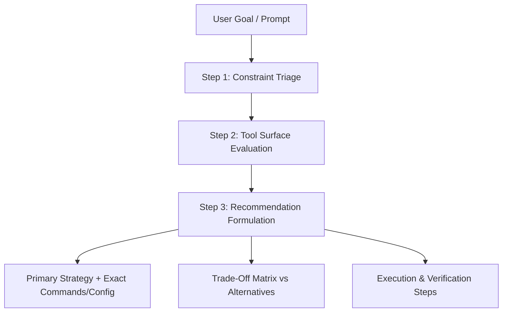

<div align="center">

# 🧠 Claude Code Knowledge Vault & Platform Master Skill

**The definitive, production-grade Obsidian Open Knowledge Vault and autonomous Agent Skill for the Claude Code platform and Anthropic developer ecosystem.**

[](https://opensource.org/licenses/MIT)
[-blueviolet)](https://agentskills.io)
[](https://code.claude.com)
[](https://github.com)
[-success)](./00_MOC/Vault_Statistics_and_Audit.md)
[](./00_MOC/MOC_Claude_Code.md)

[Quickstart](#-quickstart-install-in-10-seconds) •
[The Master Skill](#-claude-platform-master-skill) •
[Decision Matrices](#-comparative-decision-matrices) •
[Obsidian Vault](#-obsidian-knowledge-vault) •
[Contributing](#-contributing)

</div>

---

## ⚡ Quickstart: Install in 10 Seconds

Adopt the **`claude-platform-master`** skill into your environment with a single command:

### Option 1: One-Line Remote Installer (macOS & Linux)
```bash
curl -fsSL https://raw.githubusercontent.com/joaquincaste/claude-code-knowledge-vault/main/install.sh | bash
```
> *Auto-detects whether you use **Claude Code** (`~/.claude/skills/`) or **Google Antigravity** (`~/.gemini/config/skills/`) and configures paths automatically.*

### Option 2: Native Claude Code Plugin
In Claude Code v2.1+, install directly via the CLI:
```bash
claude plugin install https://github.com/joaquincaste/claude-code-knowledge-vault
```

### Option 3: Windows PowerShell
```powershell
irm https://raw.githubusercontent.com/joaquincaste/claude-code-knowledge-vault/main/install.ps1 | iex
```

### Option 4: Install to Current Project Repo
```bash
git clone https://github.com/joaquincaste/claude-code-knowledge-vault.git
cd your-project-repo
/path/to/claude-code-knowledge-vault/install.sh --project
```

---

## 🎯 Claude Platform Master Skill

The repository includes a battle-tested agent skill (`skills/claude-platform-master/SKILL.md`) that acts as an expert consultant on the Claude Code ecosystem. When given any programming goal, architectural question, or pipeline prompt, it triages constraints and recommends the optimal combination of Claude runtimes, memory layers, lifecycle hooks, and tools.

### 3-Step Consultation Framework



1. **Constraint Triage**: Assesses interactivity (REPL vs Headless `-p`), autonomy duration (`/goal`), scale (single file vs Git worktree swarm), determinism (Hooks vs Prompts), and security threat model (AutoMode vs Sandboxed Bash).
2. **Tool Surface Evaluation**: Evaluates all available Claude tools, CLI flags, memory files (`CLAUDE.md`), MCP servers, and lifecycle hooks.
3. **Recommendation Formulation**: Produces a standardized response with a primary solution, copy-paste configurations, an alternatives trade-off matrix, and verification steps.

### Example Interaction

> **User**: *"I have 60 failing TypeScript tests after a library upgrade. I want Claude to work autonomously overnight to fix them without asking for permission on every edit, but without risking accidental git hard resets."*

> **Claude Platform Master**:
> 1. **Triage**: Long-running autonomous loop + code verification.
> 2. **Primary Strategy**: Autonomous `/goal` with `autoMode` permission classifier:
>    ```bash
>    claude --permission-mode autoMode --model opus
>    ```
>    Prompt: `/goal All failing tests in npm test must pass and npm run build must succeed.`
> 3. **Deterministic Safety Guardrail**: Adds a `PreToolUse` hook in `.claude/settings.json` to block `git reset --hard` at the OS level (100% deterministic, zero LLM hallucination).
> 4. **Trade-Off Matrix**: Contrasts `/goal` vs headless `-p` vs bare `--dangerously-skip-permissions`.

---

## 📊 Comparative Decision Matrices

Located in [`70_Tool_Selection_Matrix/`](./70_Tool_Selection_Matrix/), these matrices provide rigorous trade-off evaluations:

| Decision Matrix | Questions Answered |
| :--- | :--- |
| [**Execution Modes**](./70_Tool_Selection_Matrix/Matrix_Execution_Modes.md) | Interactive REPL vs Headless Script (`-p`) vs Autonomous Goal (`/goal`) vs Background Agent View vs Agent SDK. |
| [**Extensibility Options**](./70_Tool_Selection_Matrix/Matrix_Extensibility.md) | When to use a Custom Skill vs Slash Command vs MCP Server vs Lifecycle Hook vs Plugin vs Mod. |
| [**Memory Architectures**](./70_Tool_Selection_Matrix/Matrix_Memory_Architectures.md) | Enterprise Settings vs Root `CLAUDE.md` vs Subdir `CLAUDE.md` vs Auto-Memory (`MEMORY.md`) vs Session Context. |
| [**Tool Approval & Security**](./70_Tool_Selection_Matrix/Matrix_Tool_Approval_and_Security.md) | Interactive Approval vs Auto-Mode Classifier vs Sandboxed Bash vs Devcontainers vs Air-gapped runners. |
| [**Agentic Coordination**](./70_Tool_Selection_Matrix/Matrix_Agentic_Coordination.md) | Inline Agent vs Subagents vs Git Worktree Isolation (`--worktree`) vs Agent Teams vs Dynamic Workflows. |

---

## 📚 Obsidian Knowledge Vault

This repository is formatted as a full **Obsidian Knowledge Vault** adhering to the **Open Knowledge** atomic note standard:

- **243 Atomic Notes** covering 100% of the official Claude Code documentation (CLI, Architecture, SDK, MCP, Hooks, CI/CD, Enterprise Gateways, What's New digests).
- **10,780+ Bidirectional `[[wikilinks]]`** connecting concepts across the entire documentation graph.
- **YAML Frontmatter**: Standardized metadata (`title`, `aliases`, `tags`, `source_url`, `status`, `last_updated`) on every note.
- **Zero Broken Links**: Verified with automated graph integrity testing.

### How to Open in Obsidian

1. Clone the repository:
   ```bash
   git clone https://github.com/joaquincaste/claude-code-knowledge-vault.git
   ```
2. Open **Obsidian**.
3. Select **"Open folder as vault"** and choose the cloned directory.
4. Open [`00_MOC/MOC_Claude_Code.md`](./00_MOC/MOC_Claude_Code.md) as your central dashboard.
5. Press `Ctrl+G` (or `Cmd+G`) to explore the full interactive graph view!

### Maps of Content (MOCs)

- [`MOC_Claude_Code.md`](./00_MOC/MOC_Claude_Code.md) — Master central index
- [`MOC_Core_Architecture.md`](./00_MOC/MOC_Core_Architecture.md) — Agentic loop, context window, caching, models
- [`MOC_CLI_and_Runtime.md`](./00_MOC/MOC_CLI_and_Runtime.md) — Commands, flags, REPL, terminal ergonomics
- [`MOC_Memory_and_Context.md`](./00_MOC/MOC_Memory_and_Context.md) — `CLAUDE.md`, `AGENTS.md`, settings precedence
- [`MOC_Extensibility_and_MCP.md`](./00_MOC/MOC_Extensibility_and_MCP.md) — MCP servers, plugins, mods, skills
- [`MOC_Hooks_and_Automation.md`](./00_MOC/MOC_Hooks_and_Automation.md) — Lifecycle hooks, channels, scheduling
- [`MOC_Workflows_and_Patterns.md`](./00_MOC/MOC_Workflows_and_Patterns.md) — Subagents, worktrees, CI/CD, desktop
- [`MOC_Agent_SDK.md`](./00_MOC/MOC_Agent_SDK.md) — Python & TypeScript Agent SDK
- [`MOC_Administration_and_Security.md`](./00_MOC/MOC_Administration_and_Security.md) — Gateways, AWS Bedrock, GCP, HIPAA
- [`MOC_Release_Notes.md`](./00_MOC/MOC_Release_Notes.md) — Weekly release digests (2026-w13 to 2026-w37)
- [`Vault_Statistics_and_Audit.md`](./00_MOC/Vault_Statistics_and_Audit.md) — Automated link integrity verification

---

## 📁 Repository Layout

```text
├── .claude-plugin/
│   └── plugin.json                   # Official Claude Code plugin manifest
├── .github/
│   ├── workflows/ci.yml              # CI quality gate (link integrity, YAML lint)
│   └── ISSUE_TEMPLATE/               # Bug reports & documentation update templates
├── 00_Meta/                          # Automated ingestion, audit & test scripts
├── 00_MOC/                           # 11 Obsidian Maps of Content
├── 10_Core_Architecture/             # 13 Atomic Notes (Loop, Context, Models)
├── 20_CLI_and_Commands/              # 17 Atomic Notes (Commands, Flags, REPL)
├── 30_Memory_and_Config/             # 7 Atomic Notes (CLAUDE.md, settings.json)
├── 35_Administration_and_Security/   # 36 Atomic Notes (Gateways, AWS, GCP, HIPAA)
├── 40_Extensibility_and_MCP/         # 35 Atomic Notes (MCP, Plugins, Mods, Skills)
├── 45_Agent_SDK/                     # 32 Atomic Notes (Python & TypeScript SDK)
├── 50_Hooks_and_Events/              # 5 Atomic Notes (Hooks, Channels, Automation)
├── 60_Workflows_and_Patterns/        # 51 Atomic Notes (Subagents, Worktrees, CI/CD)
├── 70_Tool_Selection_Matrix/         # 5 Comparative Decision Trees
├── 90_Release_Notes/                 # 25 Weekly Release Digests
├── skills/
│   └── claude-platform-master/       # Standalone installable skill package
│       ├── SKILL.md                  # Progressive disclosure instructions (76 lines)
│       └── references/
│           ├── capability_cheat_sheet.md
│           └── consultation_examples.md
├── install.sh                        # Universal POSIX 1-line installer
├── install.ps1                       # Windows PowerShell installer
├── README.md                         # Public landing documentation
├── CONTRIBUTING.md                   # Contribution & update guidelines
├── CHANGELOG.md                      # Release log (v1.0.0)
└── LICENSE                           # MIT License
```

---

## 🛠️ Verification & Quality Assurance

To ensure zero link rot, this repository includes continuous validation:

```bash
# Run the link integrity and placeholder auditor
python3 00_Meta/audit_vault.py

# Test the installer in dry-run mode
bash install.sh --dry-run
```

**Audit Status**:
- **Total Markdown Notes**: 243
- **Total Verified Wikilinks**: 10,780
- **Broken Wikilinks**: **0**
- **Status**: **100% Verified & Healthy**

---

## 🤝 Contributing

We welcome community contributions, especially updates reflecting new Claude Code releases!
See [CONTRIBUTING.md](./CONTRIBUTING.md) for details on re-crawling documentation and submitting pull requests.

---

## 📄 License

This project is licensed under the [MIT License](./LICENSE). Official documentation contents derived from Anthropic's Claude Code public documentation.
